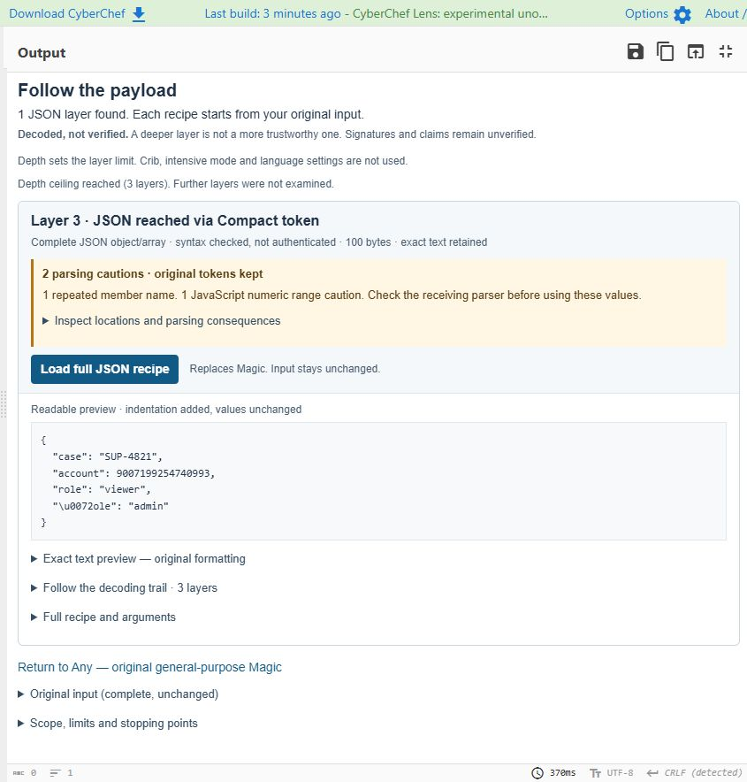

# CyberChef Lens

**Decode the layers. Keep the evidence.**

An unofficial CyberChef fork for investigating encoded JSON. Follow a payload
through its wrappers, inspect what each step produced, and load the native recipe
that reproduces it. Large numbers, repeated fields and original text stay intact.

The added investigation runs in your browser, without a model or external
service. General-purpose Magic remains available under **Any**.
[Scope and security limits](docs/SECURITY-LIMITS.md) ·
[Upstream documentation](UPSTREAM-README.md) · [Apache-2.0](LICENSE)

## Try one investigation

A session export can decode cleanly and still deserve a closer look. This
**fictional training sample** wraps a paired session Cookie in Base64; inside
the Cookie is a compact token. Its signatures are fabricated.

1. Put [the sample input](examples/lens-investigation.txt) in **Input**—drag the
   downloaded file into the app, or copy its complete text.
2. Add **Magic**, leave **Depth** at **3**, and choose
   **Output goal → JSON payload trail**.
3. Open **Inspect locations and parsing consequences**, then
   **Follow the decoding trail**. Choose **Load full JSON recipe** to replay
   the extraction from your unchanged original input.



The recovered document contains:

```json
{
  "case": "SUP-4821",
  "account": 9007199254740993,
  "role": "viewer",
  "\u0072ole": "admin"
}
```

There are two reasons not to tidy this up with an ordinary parse-and-reserialize
formatter. The account number becomes `9007199254740992` when written back through
JavaScript's number type. And `"role"` and `"\u0072ole"` name the same member:
JavaScript's parser keeps only the later `"admin"` value.

Lens preserves the original tokens and points to both problems. It does not
choose a role, authenticate a session or decide how another application should
interpret the document.

[Sample files and manual recipe](examples/README.md) ·
[Exact reference payload](examples/lens-investigation-payload.txt)

Stock CyberChef can decode these layers with native operations too. The included
five-operation recipe is the competent manual route. Lens adds automatic guarded
composition, complete-output checks and a review that keeps the evidence visible.
This demonstration is not a benchmark or a real incident.

## What's different from upstream

Available now:

- **JSON payload trail:** compose recognized transport and container layers,
  inspect intermediate text, and load a complete recipe for any reached layer.
  Different JSON layers remain separate; deeper is not more trustworthy.
- **Lossless JSON inspection:** format strict JSON without rounding numbers or
  dropping duplicate members; compare the formatted texts with an opt-in Diff
  mode. Lens also locates the first changed token across checked results.
- **Parsing cautions:** locate repeated member names and selected JavaScript
  numeric range problems before passing a decoded document to another tool.
  Original fields and number spellings stay intact; no value is silently chosen.
- Replays native candidate recipes on complete input and checks strict UTF-8 and
  whole-document JSON, instead of accepting a valid-looking prefix.
- Retains competing exact texts and recipe provenance. A syntax match does not
  choose an intended interpretation or authenticate a message.
- Recognizes a bounded set of JSON-bearing containers, including compact tokens,
  paired cookies, JSON envelopes and explicitly supported compressed profiles.
- Preserves exact JSON from canonical compact tokens with signature sizes outside
  the older serializer heuristics, including a published RSA example. A checked
  encoding shape is not a verified signature or algorithm/key match.
- Uses bounded inflation for its compressed wrapper recipes: one layer, 64 KiB
  compressed input, 1 MiB decoded-output cap, no partial payload result. Raw
  DEFLATE has no checksum. Timers are cooperative, not a process sandbox.

The recorded engineering comparison recovered all eight selected public JSON
targets automatically, versus four with the pinned native Magic baseline. Manual
recipes recovered all eight. This was a small selected set, including repairs
on known misses—not a blind benchmark or a general accuracy claim. See
[comparison scope and sources](docs/COMPARISON.md).

## Coverage and limits

The trail follows a finite set of Base64, hexadecimal, percent-encoding and
guarded container profiles. It does not decode arbitrary encoded-looking strings
inside an existing JSON document. Depth means logical layers, from 0 to 5; the
other Magic search settings do not apply. State, replay, byte and cooperative-time
limits appear in the result. Reaching a JSON layer does not authenticate it.

This is an experimental unofficial fork, not an official GCHQ release or a
production-security certification.
[Security and compatibility limits](docs/SECURITY-LIMITS.md) ·
[Third-party notices](THIRD_PARTY_NOTICES.md)

## A formatter should not change the evidence

These are different account numbers:

```text
{"account":9007199254740992}

{"account":9007199254740993}
```

Parsing both through an ordinary JavaScript number and writing them back can
make them identical. Repeated object members can disappear in the same trip.
For an investigation, that is a poor time to tidy up.

In **JSON Beautify**, enable **Lossless strict JSON**. It copies the original
number, string and punctuation tokens, replacing only insignificant whitespace.
The two account numbers stay different. Repeated members, escape spelling and
member order remain intact. This mode accepts strict JSON, not JSON5, and does
not sort keys.

For a full comparison, select **Diff → JSON (lossless)** and supply two documents
separated by your sample delimiter. The example above uses the default blank-line
delimiter. Or use **Compare checked texts** in a Lens
investigation to locate the first differing token. A formatting-only match does
not merge the original results or choose a decoding route.

Native Character Diff and raw JSON Diff already preserve differences in these
source strings. The addition is a lossless formatting-and-comparison workflow
and an integrated review, not a claim that native Diff cannot find the change.
Member order, numeric spelling and string escapes stay significant here; the
comparison does not decide semantic equivalence or authenticate either message.

The new text-inspection paths are bounded to 64 KiB per document, 16,384 tokens
and 64 nested containers. Formatting output is capped at 1 MiB. Lens compares
at most eight retained texts against one explicit reference and shows only the
first changed token. The opt-in full Diff has cooperative work limits and
refuses a completion claim if it cannot finish.

Valid JSON is not the end of the investigation. Consider:

```json
{"role":"reader","\u0072ole":"admin","account":9007199254740993}
```

The two role names decode to the same string. JavaScript's ordinary JSON parser
keeps the later value and rounds the account number; another consumer may handle
them differently. Lens shows **2 parsing cautions**, with the original locations
and the exact tokens. Open **Inspect locations and parsing consequences** before
using the recovered values. It does not choose a role or replace the account ID.

These selected checks appear on Lens result cards and in JSON Beautify's opt-in
lossless formatted view. They cover repeated names, numeric overflow, nonzero
numbers becoming zero, and magnitudes outside JavaScript's safe-integer range.
They are not a complete floating-point precision or security audit. A quiet card
is not a safety verdict. Inspection is limited to the text budgets above, with
at most 16 detailed findings shown and complete counts for an inspected document.

## Published-format check

The source-led checks include the [RFC 7515 compact and JSON examples](https://www.rfc-editor.org/rfc/rfc7515.html#appendix-A).
All six selected JSON-bearing representations now yield their exact payload in
the focused and trail modes. They share one payload, so this is format coverage,
not six independent messages or an accuracy benchmark. Native Magic already
recovers the values in three of them, and manual recipes recover all six.
See [the comparison scope](docs/COMPARISON.md#rfc-format-coverage).

One known copying-context gap remains: a token prefixed with `Authorization:
Bearer` is not automatically stripped by these profiles. Remove that prefix
manually before investigation. Unencoded/detached payloads and arbitrary HTTP
captures are not newly supported by the signature-coverage change.

## Roadmap

The experimental JSON investigation, multi-layer payload trail and lossless JSON
inspection are available with portable tests and a source build. Clean-install
CI still needs a completed remote run. Broader encoding coverage and stronger
resource isolation need their
own evidence before they are advertised; no delivery date is promised.

## Run from source

Use Node.js 24 and the included lockfile:

```sh
npm ci --ignore-scripts --no-audit --no-fund
npm run prepare:magic-json
npm test
npm run test:magic-json
npm run build
```

The preparation command runs only the inspected source generators and the two
existing upstream compatibility fixes. It does not run dependency lifecycle
hooks, download a browser, configure a global package or publish anything.

The built application is in `build/prod/index.html`; the same directory contains
a standalone ZIP with its licenses. Serve the directory locally to exercise the
production bundle. Add **Magic**, leave depth at **3**, and choose **Output goal →
JSON object or array**. **JSON wrappers** checks a single container; **JSON payload
trail** follows recognized layers without running generic search.

The check-only workflow runs native tests, portable feature tests and the build.
It has read-only repository permission and no deployment or publication steps.
The package is marked private to prevent accidental npm publication.

## Attribution

Built on [GCHQ CyberChef](https://github.com/gchq/CyberChef), pinned initially to
`cc70a4530b86aff4bc40ccc74b1ad4857eccdca2`. Original source notices and license
remain intact. This fork adds the optional JSON investigation, bounded-inflate
operations and portability/release checks. It does not implement signature
verification or replace upstream cryptographic algorithms.

Example input:
[jose-jwt fixture](https://github.com/dvsekhvalnov/jose-jwt/blob/20abc4ebf916e1e36586d67609c17d045af1d503/UnitTests/TestSuite.cs).
